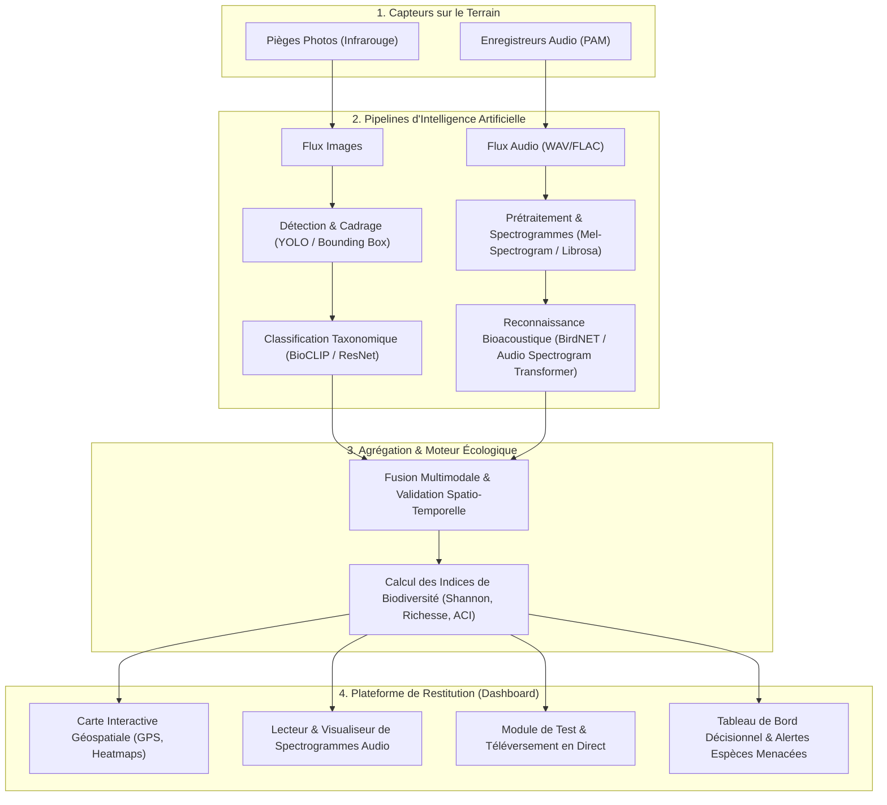

# 🌿 Plateforme de Détection et Suivi de la Biodiversité à Grande Échelle
> **Système Multimodal d'Observation et d'Analyse Écologique par Vision Artificielle et Bioacoustique**

---

## 📌 1. Contexte & Problématique Réelle

Face à l'érosion accélérée de la biodiversité mondiale, le suivi des populations animales est devenu un enjeu écologique critique. 

### Le défi du terrain :
- Les méthodes traditionnelles (inventaires manuels par des écologues) sont lentes, coûteuses et invasives pour la faune.
- Pour couvrir de vastes territoires (réserves naturelles, parcs nationaux, forêts), les scientifiques déploient désormais des **capteurs autonomes** :
  - **Pièges photographiques infrarouges (*Camera Traps*) :** déclenchés par détection de mouvement/chaleur.
  - **Enregistreurs acoustiques passifs (*Passive Acoustic Monitoring - PAM*) :** enregistrement sonore continu ou programmé.
- **Le goulot d'étranglement :** Ces réseaux génèrent des **millions de photographies et des dizaines de milliers d'heures d'enregistrements audio**. Aucun groupe de chercheurs ne peut traiter manuellement une telle masse de données (*Big Data écologique*).

---

## 🦉 2. Pourquoi la Multimodalité (Image + Son) ?

Chaque modalité physique possède des atouts et des contraintes intrinsèques. Les associer permet d'obtenir une observation continue à 360°, de jour comme de nuit.

| Dimension | 📷 Vision par Ordinateur (Images) | 🎙️ Bioacoustique (Sons) |
| :--- | :--- | :--- |
| **Champ de captation** | Directif et limité au champ optique de l'objectif. | **Omnidirectionnel (360°)**, sur plusieurs centaines de mètres. |
| **Obstacles physiques** | Bloqué par le feuillage dense, le relief ou le brouillard. | **Traverse la végétation dense** et la canopée forestière. |
| **Cycles temporels** | Idéal de jour ; nécessite des flashs infrarouges la nuit. | **Efficace 24h/24**, parfait pour la faune nocturne et crépusculaire. |
| **Cibles privilégiées** | Mammifères terrestres moyens à grands (cervidés, félins, canidés). | Oiseaux, chauves-souris (ultrasons), amphibiens, insectes, cétacés. |
| **Limites** | Inefficace si l'animal est dissimulé ou hors-champ. | Difficile de dénombrer les individus qui émettent simultanément. |

> **Synergie :** Un oiseau chanteur perché dans la canopée sera identifié par son chant sans être vu. À l'inverse, un lynx se déplaçant sans bruit sera immortalisé par le piège photographique.

---

## 🛰️ 3. Que signifie "À Grande Échelle" (*Large-Scale*) ?

Ce projet dépasse l'analyse d'un simple fichier isolé sur un ordinateur portable :
1. **Réseau maillé de stations :** Déploiement de dizaines ou centaines de points d'écoute et de vision géolocalisés (coordonnées GPS, altitude, biome).
2. **Traitement automatisé des flux :** Ingestion en continu ou par lots (*batch processing*) avec filtrage automatique des faux positifs (vent, branches qui bougent, pluie).
3. **Calcul d'indicateurs écologiques globaux :**
   - **Richesse spécifique :** Nombre total d'espèces distinctes répertoriées.
   - **Indice de diversité de Shannon ($H'$) :** Mesure de l'équitabilité et de l'abondance relative des espèces.
   - **Indice de complexité acoustique (ACI) :** Évaluation de la santé de l'écosystème sonore sans nécessairement identifier chaque espèce.
   - **Rythmes circadiens :** Analyse des heures d'activité maximale (aube, zénith, crépuscule, nuit).
   - **Surveillance UICN :** Détection précoce d'espèces en danger critique (CR), en danger (EN) ou vulnérables (VU), ainsi que des espèces invasives.

---

## ⚙️ 4. Architecture Technique de Bout en Bout

---

## 🔬 5. Fonctionnement Détaillé des Modèles IA

### A. Branche Vision (Computer Vision)
1. **Détection d'objets :** Le modèle détecte la présence d'un organisme vivant et isole la zone d'intérêt (*bounding box*), éliminant les déclenchements vides (feuilles agitées par le vent).
2. **Classification taxonomique :** Le réseau identifie le genre et l'espèce (ex: *Canis lupus*, *Lynx pardinus*) et associe un score de confiance probabiliste.

### B. Branche Bioacoustique (Audio)
1. **Extraction de spectrogramme :** Le signal sonore continu est segmenté (ex: tranches de 3 secondes) puis transformé via la transformée de Fourier à court terme (STFT) en **spectrogramme Mel**. Cela convertit une onde sonore en une représentation visuelle temps/fréquence/énergie.
2. **Classification neuronale :** Un réseau de neurones convolutif ou un transformeur audio (ex: *BirdNET*) traite le spectrogramme comme une image pour en extraire les signatures acoustiques caractéristiques (chants territoriaux, cris d'alarme).

---

## 📦 6. Livrables Recommandés pour le Projet d'Études

1. **Interface Web & Démonstrateur Interactif :**
   - Tableau de bord moderne avec statistiques globales et alertes écologiques.
   - Carte géographique dynamique affichant les observations (espèces, dates, coordonnées).
   - Visualiseur interactif de spectrogrammes sonores avec lecture audio synchronisée.
   - Zone de test permettant de glisser-déposer une image ou un fichier audio pour obtenir une prédiction en direct.
2. **Scripts & Pipeline IA :**
   - Code de prétraitement audio (conversion en spectrogrammes) et image.
   - Inférence de modèles de pointe avec seuils de confiance.
3. **Documentation & Soutenance :**
   - Présentation de la valeur écologique, des métriques d'évaluation (précision, rappel, F1-score) et de la scalabilité du système.
